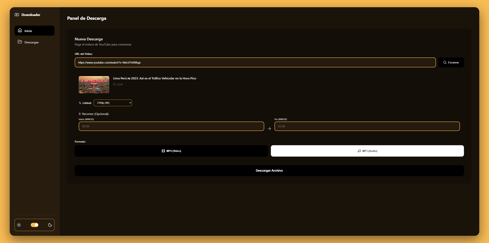

# 🎥 Downloader



[](https://www.python.org/downloads/)
[](https://fastapi.tiangolo.com/)
[](LICENSE)

Aplicación de escritorio para Windows que descarga videos y audio de YouTube, Facebook, Kick, Twitch, TikTok y más en máxima calidad. Se instala con un instalador y se actualiza sola.

## ✨ Características

- ✅ Descarga videos en formato MP4 (hasta 4K)
- ✅ Descarga audio en formato MP3 (compatible con todos los navegadores)
- ✅ Reproductor integrado para audio y video
- ✅ Interfaz web moderna y responsive
- ✅ Notificaciones modales elegantes
- ✅ Arquitectura limpia y profesional
- ✅ Sin dependencias de frontend (Vanilla JS)
- ✅ Detección automática de FFmpeg
- ✅ Soporte para múltiples plataformas (YouTube, TikTok, Facebook, Kick, Twitch)
- ✅ Compresión de PDF con optimización sin pérdida y calidad de imágenes ajustable

## Arquitectura

```
src/
├── api/              # Endpoints de la API
│   ├── __init__.py
│   └── routes.py
├── models/           # Modelos de datos (DTOs)
│   ├── __init__.py
│   └── schemas.py
├── services/         # Lógica de negocio
│   ├── __init__.py
│   └── downloader.py
├── static/           # Archivos estáticos
│   ├── css/
│   │   └── styles.css
│   └── js/
│       └── app.js
├── utils/            # Utilidades
│   ├── __init__.py
│   ├── ffmpeg_finder.py
│   └── file_utils.py
├── views/            # Templates HTML
│   └── index.html
├── __init__.py
├── app.py            # Aplicación FastAPI
├── config.py         # Configuración
└── main.py           # Punto de entrada
```

## 🚀 Inicio Rápido

### Instalación (Windows)

Descarga `UniverseDownloader-Setup-<versión>.exe` desde [Releases](https://github.com/iPool23/universe-downloader/releases) y ejecútalo. No pide administrador. Cuando haya una versión nueva, la app avisa y se actualiza sola.

### Desde el código

```bash
# Clonar el repositorio
git clone https://github.com/iPool23/universe-downloader.git
cd universe-downloader

# Instalar dependencias
pip install -r requirements.txt

# Ejecutar la aplicación
python src/main.py
```

En Windows se abre en su propia ventana. Con `python src/main.py --browser` (o en macOS) se abre en el navegador, en `http://127.0.0.1:8000`.

### Compilar y publicar (Windows)

```powershell
# Instalador: dist\UniverseDownloader-Setup-<versión>.exe (requiere Inno Setup 6)
powershell -ExecutionPolicy Bypass -File build.ps1

# Publicar una versión: sube APP_VERSION en src\version.py, haz commit y push a main, y luego
powershell -ExecutionPolicy Bypass -File release.ps1 -Notes "qué cambió"
```

## 🍎 macOS

Si vas a generar la versión para Mac, usa estos recursos dentro del proyecto:

- `mac/bin/ffmpeg`
- `mac/bin/ffprobe`
- `mac/icon.icns`

Después compila en macOS con:

```bash
python3 scripts/build.py --lite
python3 scripts/create_release.py --lite
```

También puedes usar `BUILD_MACOS.command` desde la carpeta raíz del proyecto en macOS.

El resultado será `dist/UniverseDownloader.app` y el ZIP de distribución para macOS.

Si prefieres automatizarlo en GitHub, el workflow `.github/workflows/macos-release.yml` instala Python, dependencias y FFmpeg, genera el icono de la app desde `public/imgs/favicon.ico`, compila el `.app`, crea un `.dmg` y sube los artefactos. Cuando el push es a un tag `v*`, además publica la release en GitHub.

### Requisitos

- Python 3.8+
- FFmpeg (opcional, para mejor calidad de video)

## 📖 Uso

1. Abre Universe Downloader
2. Pega el enlace del video y pulsa "Escanear"
3. Elige el formato (MP4 o MP3) y la calidad
4. Haz clic en "Descargar"
5. Elige dónde guardar el archivo

La app no usa cuentas ni cookies. Si un sitio exige iniciar sesión para un video (YouTube lo hace según la red desde la que te conectas), ese video no se puede descargar en ese momento.

## 🛠️ Tecnologías

- **FastAPI** - Framework web moderno y rápido
- **yt-dlp** - Descarga de videos de múltiples plataformas
- **Pydantic** - Validación de datos
- **Uvicorn** - Servidor ASGI
- **FFmpeg** - Procesamiento de audio y video
- **HTML/CSS/JS** - Frontend vanilla (sin frameworks)

## 🏗️ Patrones de Diseño

- **Separation of Concerns** - Separación clara entre capas
- **Dependency Injection** - Servicios inyectables
- **Repository Pattern** - Abstracción de lógica de descarga
- **DTO Pattern** - Modelos de transferencia de datos
- **Service Layer** - Lógica de negocio encapsulada

## 📚 Documentación

- [README.md](README.md) - Documentación principal
- [ARCHITECTURE.md](ARCHITECTURE.md) - Detalles de arquitectura
- [PROJECT_SUMMARY.md](PROJECT_SUMMARY.md) - Resumen del proyecto

## 🤝 Contribuir

Las contribuciones son bienvenidas. Por favor:

1. Fork el proyecto
2. Crea una rama para tu feature (`git checkout -b feature/AmazingFeature`)
3. Commit tus cambios (`git commit -m 'Add some AmazingFeature'`)
4. Push a la rama (`git push origin feature/AmazingFeature`)
5. Abre un Pull Request

## 📝 Licencia

Este proyecto está bajo la Licencia MIT. Ver el archivo `LICENSE` para más detalles.

## 👤 Autor

**Pool Anthony Deza Millones**

Desarrollador de la interfaz e integración completa del sistema.

- GitHub: [@iPool23](https://github.com/iPool23)

## ⭐ Agradecimientos

- [yt-dlp](https://github.com/yt-dlp/yt-dlp) - Por la excelente librería de descarga
- [FastAPI](https://fastapi.tiangolo.com/) - Por el increíble framework

---

⭐ Si te gusta este proyecto, dale una estrella en GitHub!
